# Student Performance Predictor

**Live Demo:** [Open Student Performance Predictor](https://student-performance-predictor-ml-9djcft3hbqkhxanhgtagy3.streamlit.app/)

A machine learning-based web application that estimates student examination scores using academic, personal, and lifestyle-related factors. The application combines data analysis, regression modelling, and interactive visualisation to help students understand their academic performance and explore factors associated with it.

## Project Overview

Student performance can be associated with several factors, including attendance, study hours, previous scores, tutoring, and access to learning resources.

This project analyses student data, trains and evaluates multiple regression models, and provides an interactive Streamlit application where users can enter student details and receive an estimated examination score.

**Objective:** To develop an end-to-end machine learning application demonstrating data preprocessing, exploratory data analysis, model comparison, prediction, visualisation, and database integration.

## Application Screenshots

The following screenshots showcase the application's interface, prediction workflow, dashboard, and features.

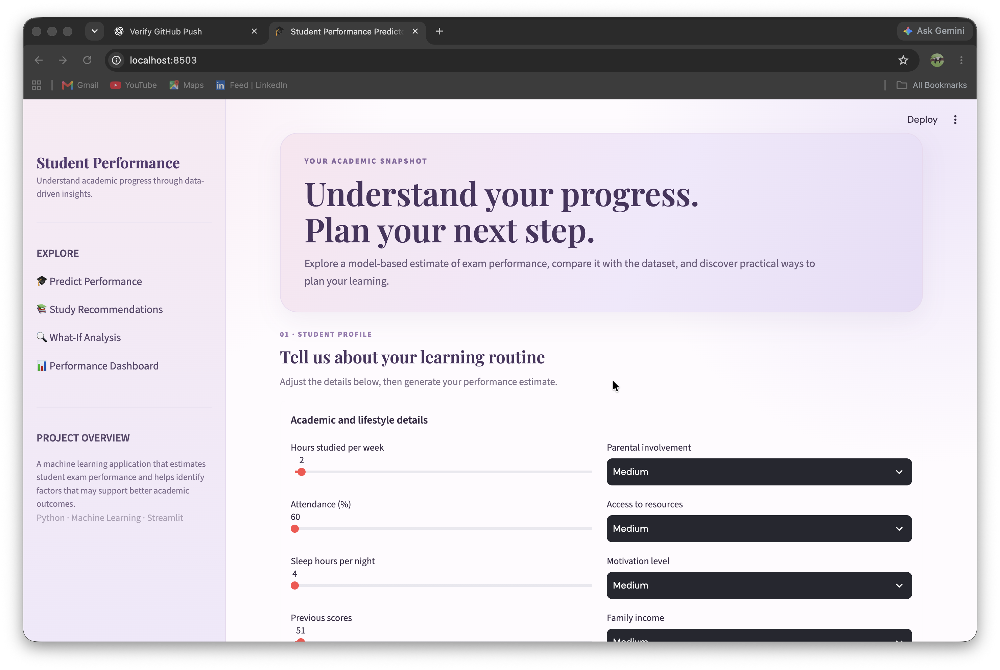

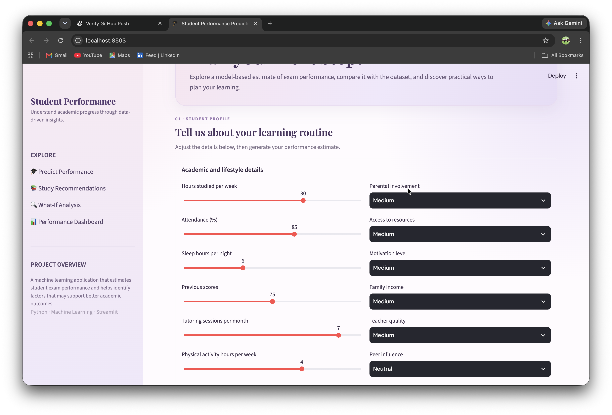

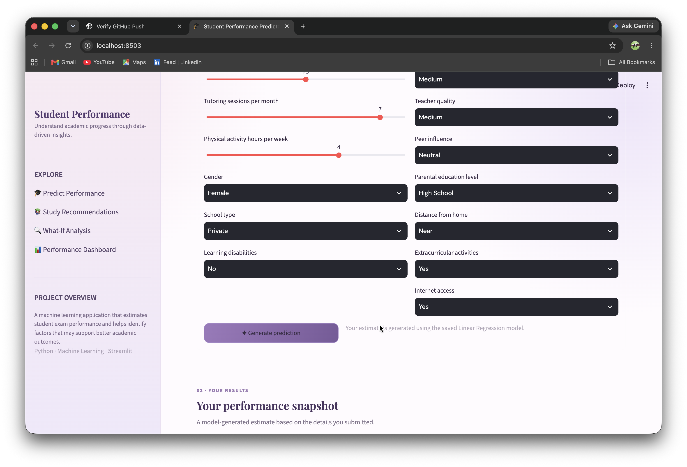

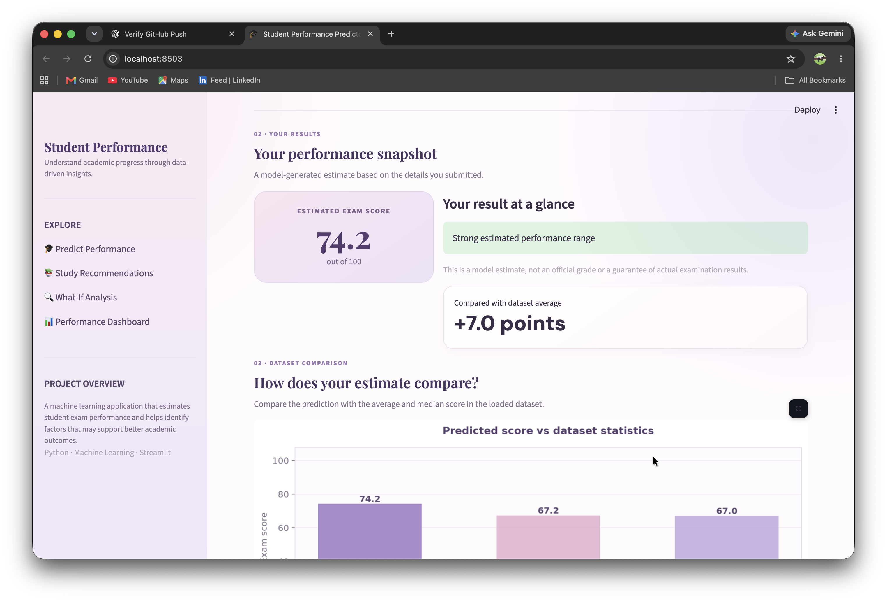

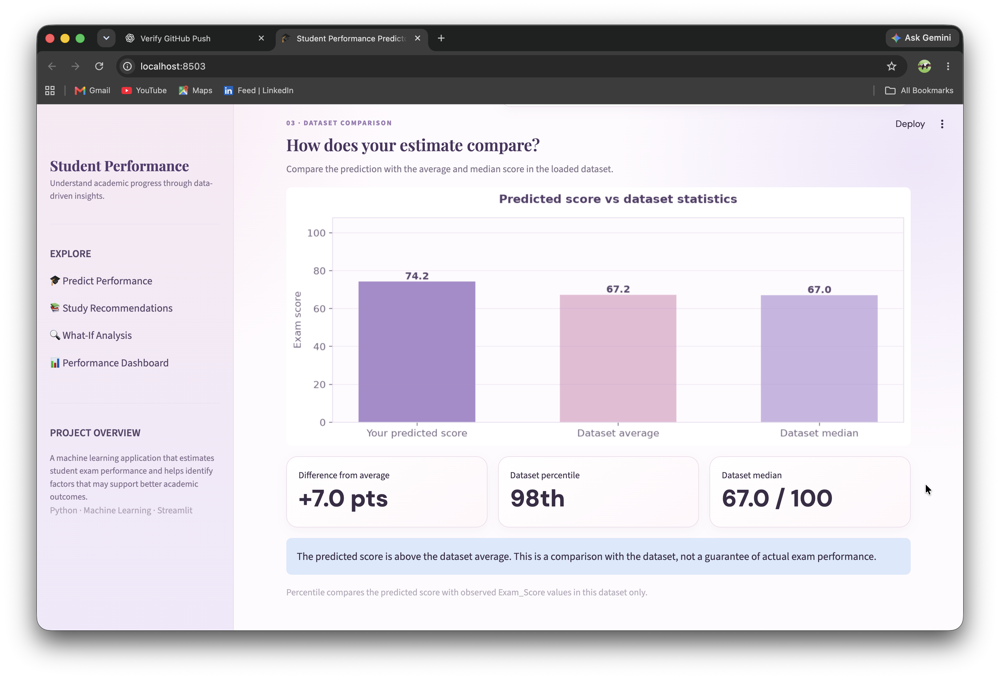

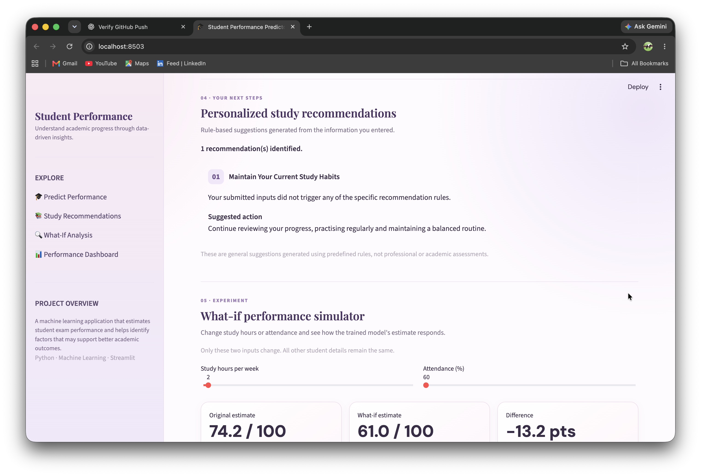

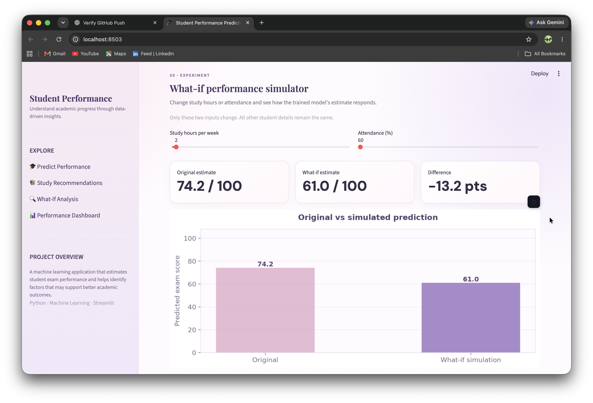

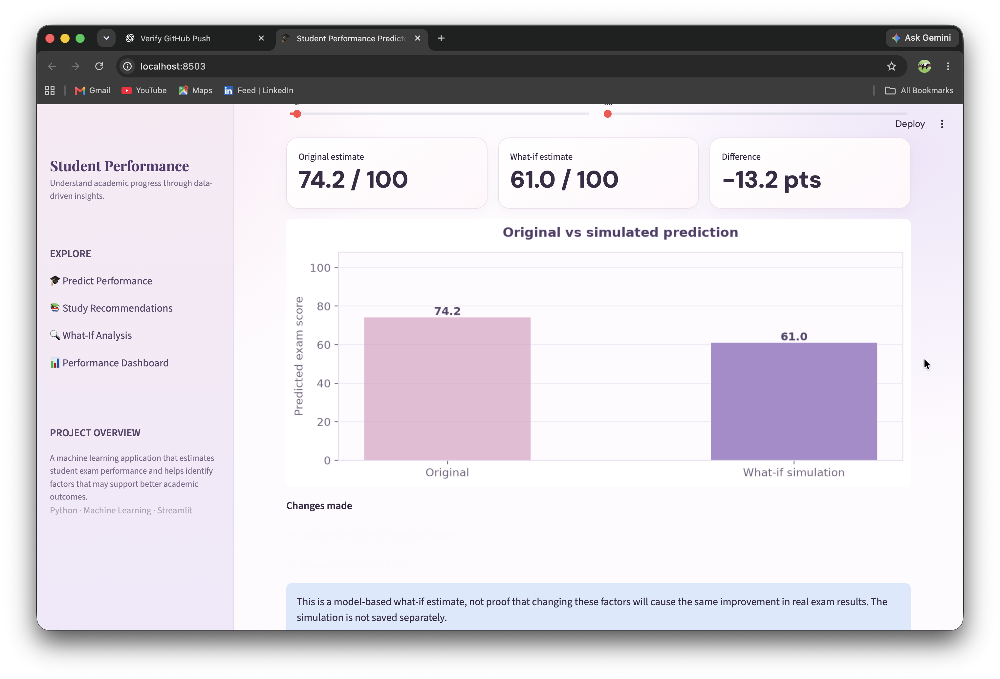

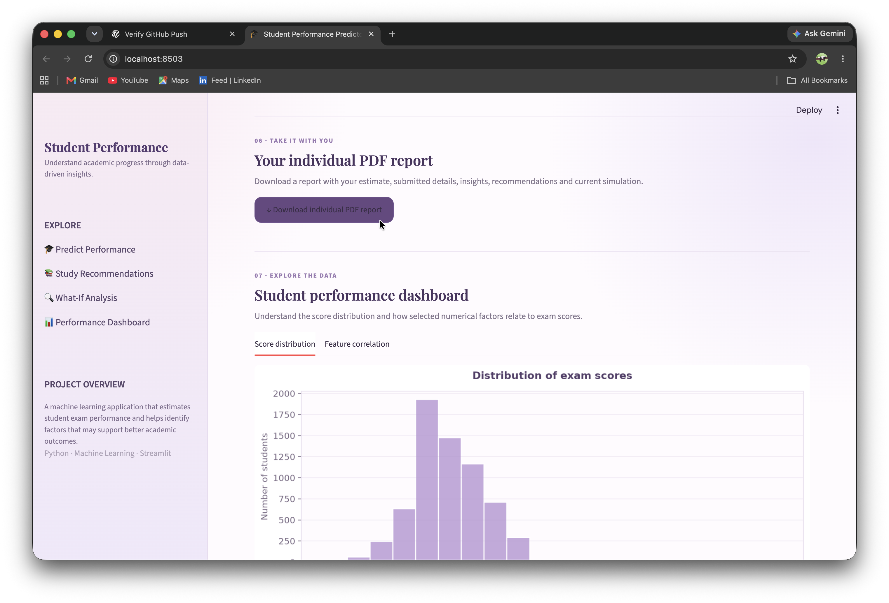

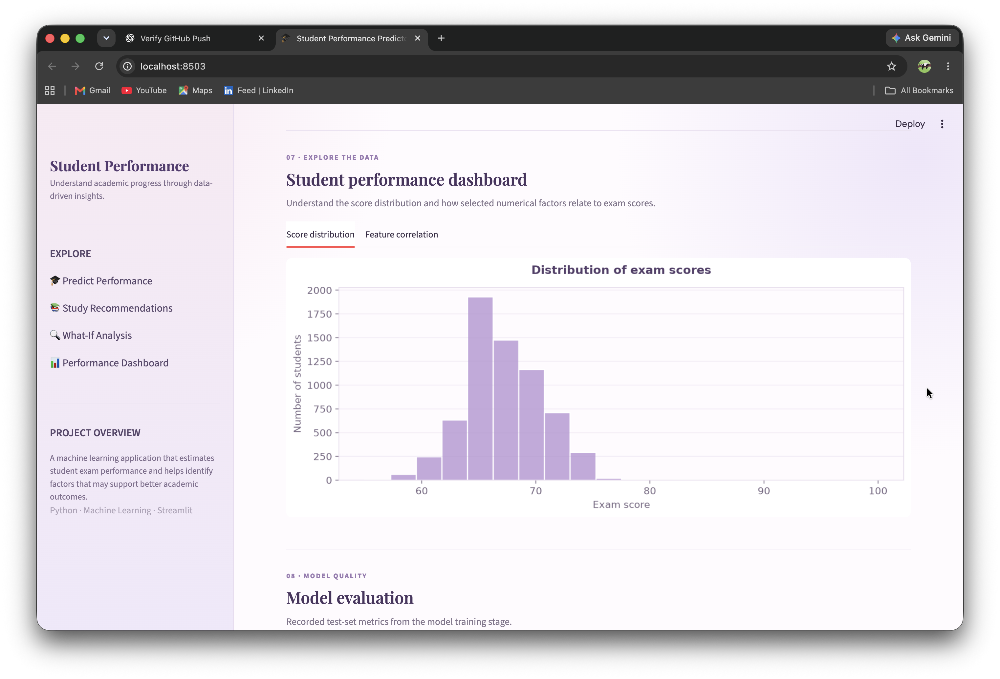

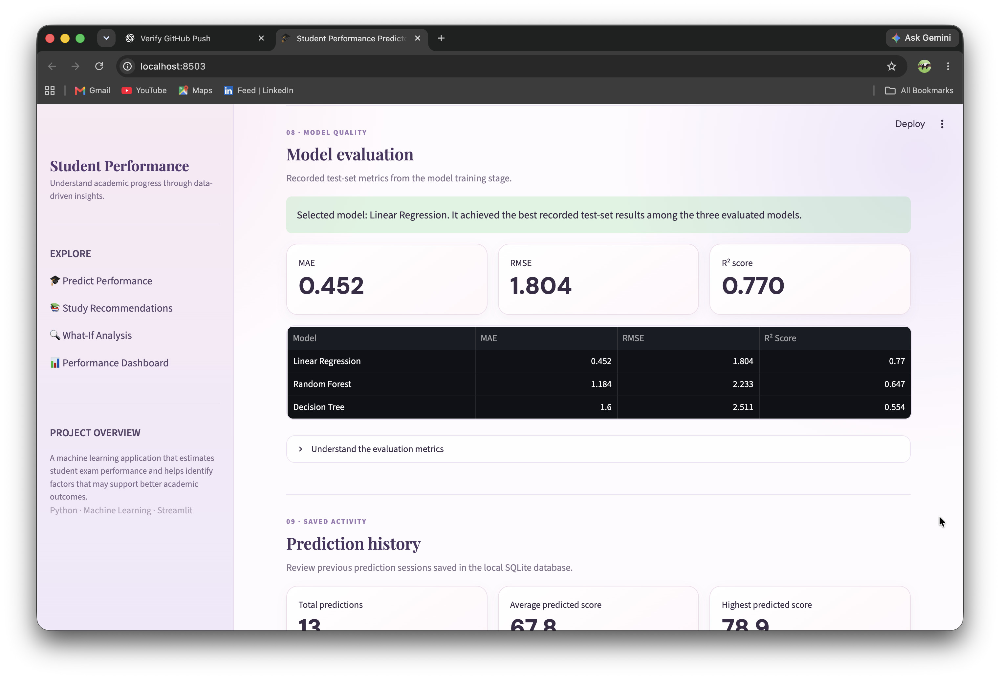

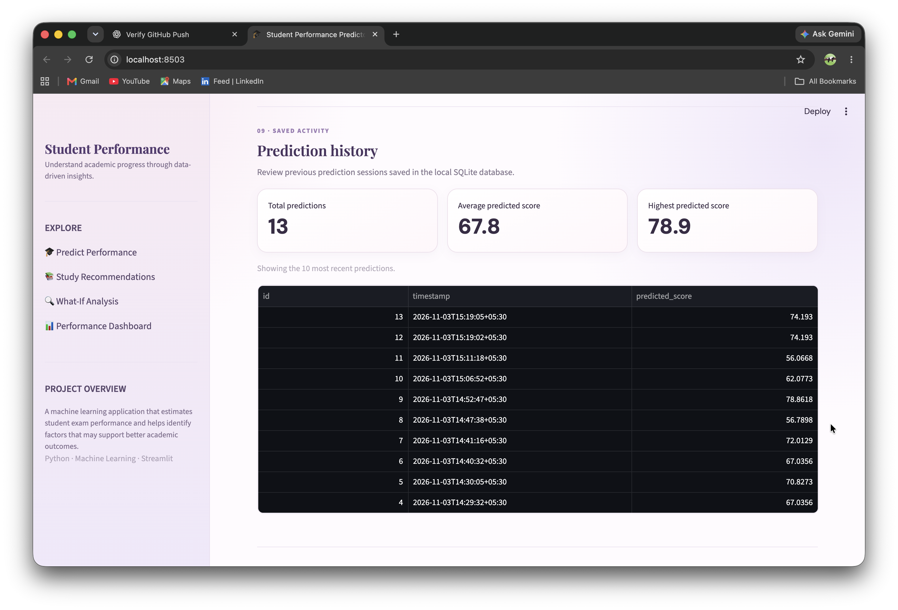

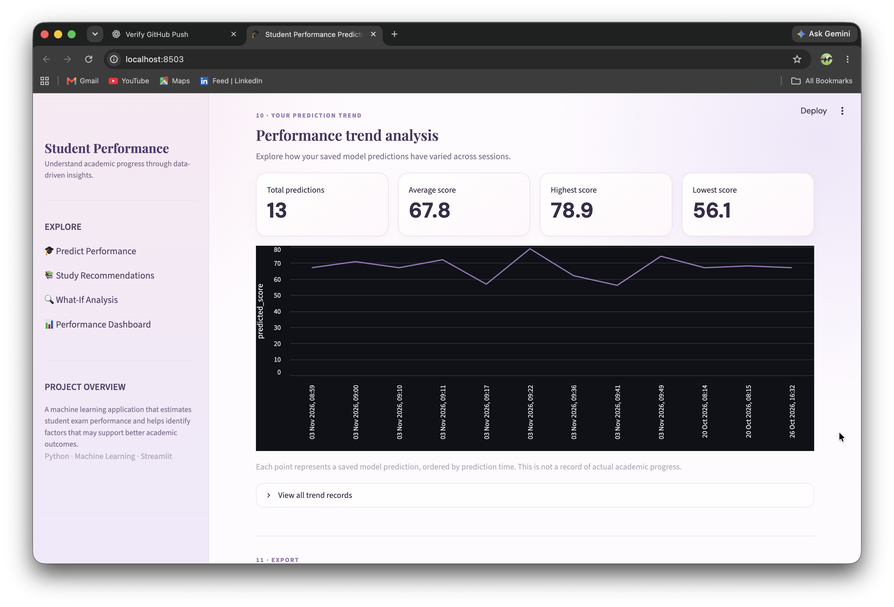

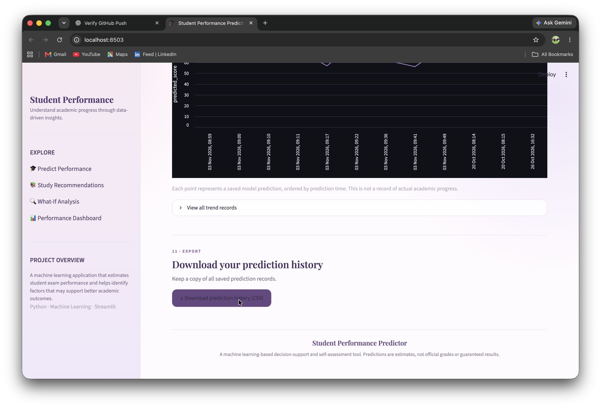

## Features

- **Student Score Prediction:** Estimate examination scores using 19 input features.
- **Interactive Input Form:** Enter academic, personal, and lifestyle-related information.
- **Performance Feedback:** Receive an interpretation of the predicted score.
- **Study Recommendations:** Get suggestions based on student information and prediction.
- **What-If Simulator:** Explore how changing selected input factors affects the estimated score.
- **Performance Dashboard:** Explore examination score distributions and feature relationships through visualisations.
- **Score Comparison:** Compare an individual prediction with dataset statistics, including the average and median.
- **Model Evaluation:** Compare Linear Regression, Random Forest, and Decision Tree using MAE, RMSE, and R².
- **Prediction History:** Store prediction timestamps, input details, and predicted scores using SQLite.
- **Prediction Insights:** View prediction summaries and analyse saved prediction records.
- **PDF Report:** Generate a downloadable report of an individual prediction.
- **CSV Export:** Download saved prediction records for further analysis.

## Dataset

**Source:** Kaggle — Student Performance Factors

- **Records:** 6,607 students
- **Columns:** 20
- **Target Variable:** `Exam_Score`
- **Input Features:** 19

The dataset contains information about students' academic habits, attendance, previous scores, sleep, tutoring, family background, school environment, and other factors.

## Project Structure

```text
Student-Performance-Predictor-ML/
├── app.py
├── requirements.txt
├── README.md
├── .gitignore
├── predictions.db
├── data/
│   ├── StudentPerformanceFactors.csv
│   └── student_data_cleaned.csv
├── models/
│   └── best_model.pkl
├── notebooks/
│   ├── 01_data_cleaning.ipynb
│   ├── 02_eda.ipynb
│   └── 03_model_training.ipynb
└── screenshot/
    ├── 1.png
    ├── 2.png
    ├── ...
    └── 14.png
```

The SQLite database is generated locally when the application runs. The structure above represents the expected project organisation.

## Methodology

### 1. Data Cleaning

- Inspected dataset dimensions, data types, and statistical summaries.
- Checked for missing values and duplicate records.
- Prepared a cleaned dataset for analysis and modelling.

**Cleaning Results:** 6,607 rows, 20 columns, zero missing values, and zero duplicate records in the cleaned dataset.

### 2. Exploratory Data Analysis

Explored the target variable distribution and relationships between numerical features and examination scores using Pandas, Matplotlib, and Seaborn.

### 3. Feature Preparation

- Separated input features from the target variable.
- Encoded categorical variables using one-hot encoding.
- Aligned prediction inputs with the feature columns used during training.
- Split the data into training and testing sets.

### 4. Model Training and Evaluation

Trained and compared three regression algorithms:

- Linear Regression
- Random Forest Regressor
- Decision Tree Regressor

The models were evaluated using Mean Absolute Error (MAE), Root Mean Squared Error (RMSE), and the coefficient of determination (R²).

### 5. Application Development

Developed an interactive Streamlit application that loads the saved model, accepts user inputs, generates score estimates, displays visualisations, provides study recommendations, and records predictions in a SQLite database.

The application also includes a What-If simulator, downloadable PDF reports, prediction insights, and a performance dashboard.

## Key Findings

The exploratory analysis identified the following relationships with `Exam_Score`:

| Feature | Correlation |
|---|---:|
| Attendance | 0.58 |
| Hours Studied | 0.45 |
| Previous Scores | Approximately 0.18 |
| Tutoring Sessions | Approximately 0.16 |
| Physical Activity | Approximately 0.03 |
| Sleep Hours | Approximately -0.02 |

Attendance and hours studied showed the strongest positive correlations among the listed numerical features.

Correlation does not establish causation. These findings describe relationships in the dataset and should not be interpreted as proof that a factor directly causes a change in examination performance.

## Model Performance

Recorded test-set evaluation results:

| Model | MAE | RMSE | R² |
|---|---:|---:|---:|
| Linear Regression | 0.452 | 1.804 | 0.770 |
| Random Forest | 1.184 | 2.233 | 0.647 |
| Decision Tree | 1.600 | 2.511 | 0.554 |

**Selected Model: Linear Regression**

Among the three evaluated models, Linear Regression achieved the lowest MAE and RMSE and the highest R² on the recorded test set.

- **MAE:** Measures the average absolute difference between actual and predicted scores. Lower is better.
- **RMSE:** Measures prediction error while penalising larger errors more strongly. Lower is better.
- **R²:** Measures how much variation in the target is explained by the model on the evaluated data. Higher is generally better.

These are recorded evaluation results, not guarantees of performance on unseen real-world students.

## Technology Stack

| Technology | Purpose |
|---|---|
| Python | Core programming language |
| Pandas and NumPy | Data manipulation and numerical operations |
| Matplotlib and Seaborn | Data visualisation |
| Scikit-learn | Machine learning and model evaluation |
| Joblib | Saving and loading the trained model |
| Streamlit | Interactive web application |
| SQLite | Prediction history storage |
| Jupyter Notebook | Data cleaning, analysis, and experimentation |
| Git and GitHub | Version control and project hosting |

## Installation and Setup

### Prerequisites

- Python installed on your computer
- Git (optional, for cloning the repository)

### 1. Clone the Repository

```bash
git clone https://github.com/jiyadhiman2907/Student-Performance-Predictor-ML.git
cd Student-Performance-Predictor-ML
```

### 2. Create a Virtual Environment

**macOS / Linux**

```bash
python3 -m venv venv
source venv/bin/activate
```

**Windows**

```bash
python -m venv venv
venv\Scripts\activate
```

### 3. Install Dependencies

```bash
pip install -r requirements.txt
```

### 4. Run the Application

```bash
streamlit run app.py
```

Streamlit will display a local URL in the terminal. Open that URL in your browser to access the application.

**Important:** Ensure that `models/best_model.pkl` and `data/student_data_cleaned.csv` are available before running the application.

## Using the Application

1. Open the Streamlit application.
2. Enter the student's academic and personal details.
3. Select the prediction option to estimate the examination score.
4. Review the estimated score and performance feedback.
5. Explore the study recommendations.
6. Use the What-If simulator to experiment with different input values.
7. Explore the performance dashboard and model evaluation results.
8. Review previously recorded predictions.
9. Generate a PDF report or download prediction history as a CSV file.

## Limitations

- Predictions are estimates based on patterns learned from the available dataset.
- Model performance on this dataset may not generalise to other schools or student populations.
- Correlations do not establish causal relationships.
- Prediction categories are simplified interpretations, not official academic grades.
- The application is intended to support self-assessment rather than replace teachers or formal evaluation.

## Future Enhancements

- Improve model generalisation through additional validation and feature engineering.
- Introduce automated model evaluation and reproducible training workflows.
- Add more interactive dashboard filters and visualisations.
- Explore additional machine learning algorithms.
- Introduce appropriate access controls and privacy protections for real student records.

## Author

**Jiya Dhiman**  
B.Tech CSE (Artificial Intelligence)  
GLA University

**Project Supervisor:** Mr. Abhishek

## Disclaimer

This project is intended for educational and self-assessment purposes. Predicted scores are estimates, not guaranteed results or official examination grades. Users should avoid entering personally identifiable student information into a publicly accessible deployment.